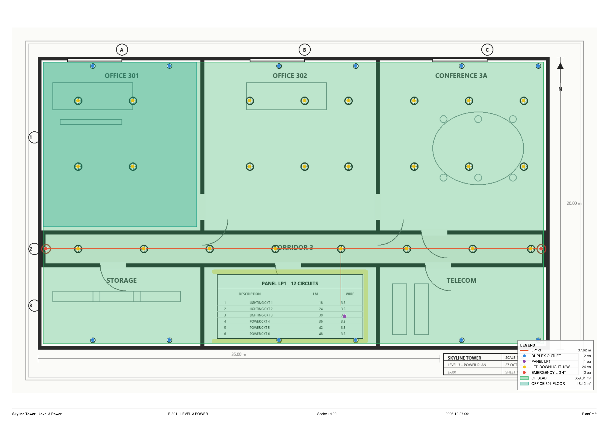

# PlanCraft

**A free, offline takeoff app for construction plans — a PlanSwift-style workflow that runs on your own PC.**

[](https://github.com/callistaaa111/plancraft/actions/workflows/ci.yml)
[](https://github.com/callistaaa111/plancraft/releases)
[](LICENSE)


Open plans, set the scale, click out counts, lengths and areas, price the materials, and export the quantities to
Excel or a PlanSwift job. It also opens your existing `.SwiftJob` files, including their pages, scales and takeoff.



*Printed by PlanCraft from a sample electrical sheet: linear, area and count takeoff, a live legend, and a title strip.*

## Download and install

1. **[Download the latest installer](https://github.com/callistaaa111/plancraft/releases/latest)** (`PlanCraft-Setup-1.1.0.exe`).
2. Run it. It installs for the current Windows user, so it does **not** need administrator rights.
3. Start **PlanCraft** from the Desktop or Start menu. It opens in its own window; closing the window stops the
   server about 10 minutes later.

Your projects live in `%LOCALAPPDATA%\PlanCraft\data` and are kept when you update or uninstall.

**Portable:** download `PlanCraft-1.1.0-portable.zip`, unpack it anywhere, and run `PlanCraft.exe`. Put an empty
`portable.txt` next to the executable to keep the projects in a `data` folder beside it.

**From source** (Python 3.10+):

```powershell
git clone https://github.com/callistaaa111/plancraft.git
cd plancraft
python -m venv .venv
.\.venv\Scripts\Activate.ps1
python -m pip install -r requirements.txt
python server.py --open
```

That opens <http://127.0.0.1:8791/>. The old `Install PlanCraft.bat` still works for a machine where Python is
already installed; it adds the same shortcuts.

## First takeoff

1. **New from PDF** (or drop a PDF on the Projects screen). Pick 150/200/300 dpi and the pages.
2. Open the page, click the scale badge in the Pages list, and either choose a standard scale or
   **Calibrate on plan** by clicking both ends of a known dimension. If the sheet prints a scale such as
   `1:100` or `1/8" = 1'-0"`, PlanCraft reads it and asks you to check it.
3. Press **Takeoff** (T), choose **New linear / area / count item**, name it and pick a colour.
4. Click on the plan. Lines and areas: double-click, Enter or right-click finishes; Backspace removes the last
   point. Counts: every click is one; Enter ends the group.
5. Press **Export > Excel summary** when you are done. There is no Save button: every change is written about a
   second later.

## What it does

### Plans

| From | How |
|---|---|
| PlanSwift job | **Open .SwiftJob** on the Projects screen, or drop the file on the page. Pages, scales, folders and Linear / Area / Count items with their points are imported. |
| PDF | **New from PDF**, or **Add plans** inside a project. PlanCraft keeps a copy of the PDF so PDF pages print as vectors. |
| Images | PNG, JPG, TIFF (multi-page too), BMP, GIF and WebP. |

- **Crop** (C) an area into a new page, rotate a page, or copy/paste a page within or between projects.
- **Manage pages** (the panel button): rename, group, reorder, and tick several pages to apply a standard scale at
  once.
- **Search items** to jump to an item's page and zoom to its takeoff.
- **Search project** (Ctrl+Shift+F) searches page names, items, notes and the text layer of PDF pages, then jumps to
  the page. If Tesseract is installed, **OCR scanned pages** makes image-only plans searchable too.
- **Project templates:** save a project's price list, assemblies, folder/item skeleton and settings, then start a new
  job from it (pages and takeoff are never copied).
- **Try demo** creates a small sample electrical project with a plan, folders, materials, assemblies and a quote.
- **Copy/paste items and folders** works within a project and between projects; sections are restored when the target
  has the same source/page or page name.
- Scale, units and allowances are per page or per item, with metric and imperial units.

### Takeoff

- **Linear**, **area** and **count** items, in folders; each section stores its points and can live on any page.
- **Deduct** makes the next area a cut-out; **Ortho** (or Shift) constrains runs; **Snap** catches existing points.
- **Select** (V) edits points, Alt+click removes one, double-click a line adds one, Del deletes; Ctrl+Z / Ctrl+Y.
- Count items can be **box-selected** on the plan and deleted in one go. **Focus** (G) fades the rest of the takeoff.
- **Bulk edit** several items at once (colour, unit, allowance, assembly, visibility). Each item can also carry a
  **manual adjustment** with a reason, and a **Flag for review** marker.
- **P** hides the properties panel. **?** shows every shortcut. **Ctrl+K** opens the command palette.

### Auto count

Select a count item, press **Auto count** (A), zoom to the area and drag a box tightly around **one** symbol.
PlanCraft finds look-alikes (only in the visible part of the page by default), shows green/grey/red circles, and adds
the ones you keep. **Symbol shape** compares a whole symbol; **Dots on wires** finds lights drawn as filled dots on a
circuit wire. The **Match strength** slider trades recall for precision. Always review the circles before adding.
**Save symbol** stores the boxed symbol in the project; **Symbols...** can run it across selected pages and add the
reviewed matches to a count item.

### Compare revisions

Open a page and press **Compare**, then choose another page. Red is only on this page, green only on the other, black
is unchanged. **Align** with two point pairs when the sheets do not line up, then **Copy takeoff to the other page**
to carry the takeoff across a revision. **Swap** reverses the overlay.

For a whole-project revision report, open the **...** menu on a project card and choose **Compare revisions...**.
Pick the other project: PlanCraft matches pages by source PDF/page and sheet name, then lists every item with its old
quantity, new quantity, delta and percentage. Added and removed items are called out, and **Export Excel** writes the
same report as a workbook.

### Notes and highlighter

**Note** (N) places a text box with a pin; choose font, size, colours and width, or let it grow and shrink with the
plan. **Highlight** (H) draws a marker stroke (Shift for straight). Notes and highlights are never counted as takeoff,
and notes are exported to their own Excel sheet and to the PDF.

### Materials and pricing

Open **Materials** to set up a **price list** (category, unit, price; **Whole** rounds up things sold in whole units)
and **assemblies** (recipes such as 2 × quantity + allowance of 3.5 mm² wire, plus 1 × quantity ÷ 3 conduit). Assign an
assembly to an item or a folder; the panel shows materials and cost, and the Excel export gets a **Bill of Materials**,
**Materials by Item** and **Quote** sheet with live formulas and totals. **Import from Excel / CSV** reads a supplier
price list and updates matching materials.

Tick **Labour** on a price-list row to treat it as a labour rate (for example an electrician hour). The **Quote** tab
adds overhead, contingency, markup and VAT/tax percentages and shows the full build-up: materials, labour, subtotal,
overhead, contingency, markup, tax and total. **Download proposal PDF** turns the build-up into a client-facing
one-page proposal with your company, client, project address, validity and terms.

### Print and PDF

**Print / PDF** (Ctrl+P) makes a vector PDF of the open page, all pages, or ticked pages. Choose the drawing's own
size or A4–A0 / Letter / Legal / Tabloid / ARCH D, include takeoff, a legend, notes and a title strip, then download
or open it to print. **Smaller file** uses JPEG for image pages.

### Export

- **Excel summary:** Summary, By Page, Circuits (`PANEL:` layout), Bill of Materials, Materials by Item, Notes and
  Pages.
- **PlanSwift job (.SwiftJob):** every page as a TIFF with its scale, and the takeoff folders, items, colours,
  heights and points. Deduct areas become a separate "... (deduct)" item because PlanSwift has no cut-out flag.
- **CSV summary:** the same item, quantity and allowance columns, for a quick import elsewhere.
- **Print / PDF:** as above.

## Saving, backups and recovery

There is no Save button. Every change is saved about a second later, and the browser keeps a copy immediately; if
PlanCraft or the PC goes down before a change reaches disk, the next open offers to recover it. A backup is kept every
10 minutes (the last 30) and can be restored from **Backups...**; the version you replace is kept as a backup too.
Deleted projects go to `data/trash`. **Storage** on the Projects screen shows the data folder, project, template
and trash sizes, and lets you empty the trash. **Duplicate project** copies the plan set and takeoff into a new project;
**Pin to top** keeps a job at the top of the list.

**Move a project to another PC:** use **Export project archive (.zip)** in a project's **...** menu, then
**Import archive** on the Projects screen. The archive contains the project, its page images and source PDFs, and
importing always creates a new project, so it never overwrites one.

Projects are plain folders under the data directory (`project.json`, page images, backups, sources). They are not
encrypted; use BitLocker for confidential client plans.

## Development

```powershell
python -m venv .venv
.\.venv\Scripts\Activate.ps1
python -m pip install -r requirements-dev.txt

python server.py --open                              # run from source
python -m unittest discover -s tests -v              # 52 tests
ruff check .                                         # lint
python -m coverage run -m unittest discover -s tests
python -m coverage report -m
python scripts/privacy_scan.py                       # no client documents or secrets
powershell -NoProfile -ExecutionPolicy Bypass -File .\scripts\build.ps1
# or double-click "Build PlanCraft.bat"
# PyInstaller app + portable zip + installer (installer needs Inno Setup)
```

The release build needs [Inno Setup](https://jrsoftware.org/isdl.php) for the installer. `scripts/build.ps1` skips it
with a warning when it is not installed. The CI workflow tests Python 3.10–3.13 and runs ruff; the release workflow
builds the installer and portable zip on a `v*` tag and publishes them to GitHub Releases.

### Layout

```
server.py          local HTTP server, API, static files, launcher
store.py           one folder per project, atomic saves, backups, trash
archive.py         portable .plancraft.zip export/import
demo.py            built-in sample project for "Try demo"
compare.py         revision matching and quantity deltas
search.py          page/item/note/PDF-text search
templates.py       project templates (prices, assemblies, folders, settings)
quote.py           client proposal PDF
ocr.py             optional Tesseract OCR for scans
symbols.py         saved symbols and batch matching
export_csv.py      CSV summary export
importers.py       PDF/image/SwiftJob import, crop/rotate/copy pages
measure.py         quantities from points and page scale
vision.py          auto count and revision tinting (OpenCV)
printpdf.py        vector PDF of plans with takeoff, legend and title strip
export_xlsx.py     Excel workbook (summary, circuits, BOM, notes)
export_swiftjob.py PlanSwift job writer
pricelist.py       supplier price-list reader
pricing.py         materials, assemblies and costing
tasks.py           background import/export jobs
web/               plain ES modules + canvas UI, no bundler
tests/             52 unittest cases (quantities, imports, exports, API, security)
packaging/         PyInstaller spec and Inno Setup script
scripts/build.ps1  local release build
scripts/privacy_scan.py  blocks client documents, secrets and PII in CI
```

The server listens on `127.0.0.1` only and checks the `Host` header. It has no accounts, telemetry or cloud calls.

## Roadmap

The next work — revision delta reporting, a labour/quote layer, OCR and text search, and a storage/sync upgrade — is
sketched in [docs/ROADMAP.md](docs/ROADMAP.md). Performance and security findings live in
[docs/AUDIT.md](docs/AUDIT.md), and the comparison with other takeoff tools in
[docs/COMPETITORS.md](docs/COMPETITORS.md), and the client-data/privacy check in [docs/PRIVACY.md](docs/PRIVACY.md).

## Contributing

Issues and pull requests are welcome. Read [CONTRIBUTING.md](CONTRIBUTING.md) first, and report security problems
privately as described in [SECURITY.md](SECURITY.md).

## License

MIT. See [LICENSE](LICENSE). You are free to use, change and share PlanCraft, including for work.

## Disclaimer

PlanCraft is an independent project. It is not affiliated with, endorsed by, or sponsored by PlanSwift or its owners.
"PlanSwift" is a trademark of its respective owner and is mentioned here only to describe compatibility with
`.SwiftJob` files.

PlanCraft is provided "as is", without warranty of any kind (see [LICENSE](LICENSE)). Always check quantities before
using them in an estimate, bid or order.
